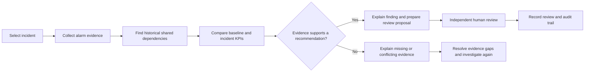
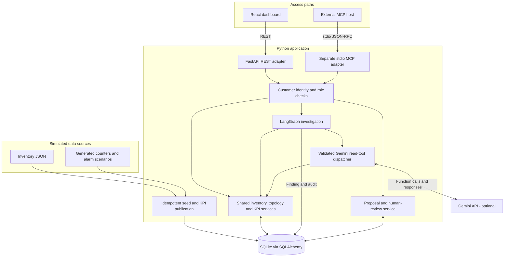
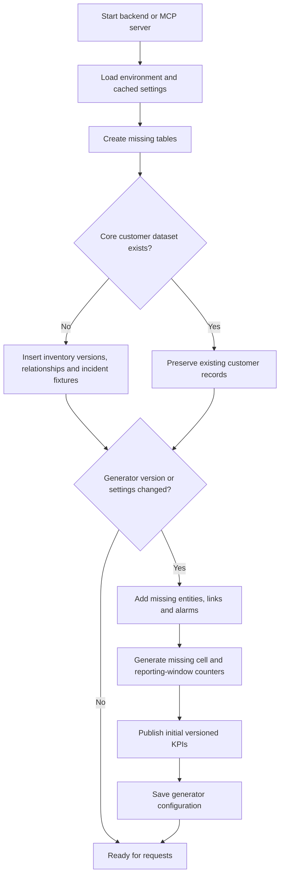
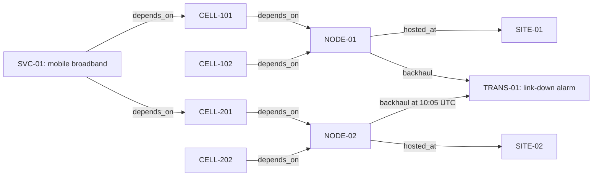
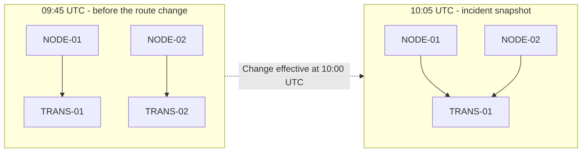
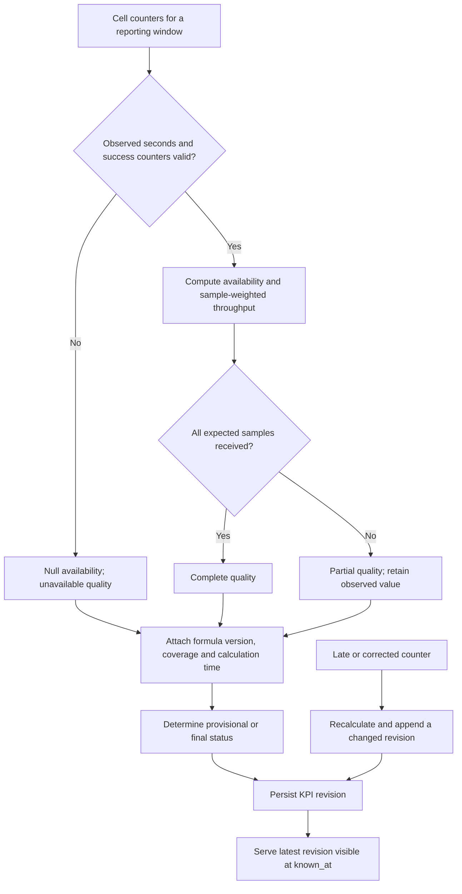
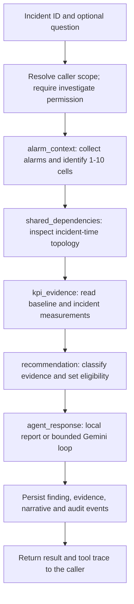
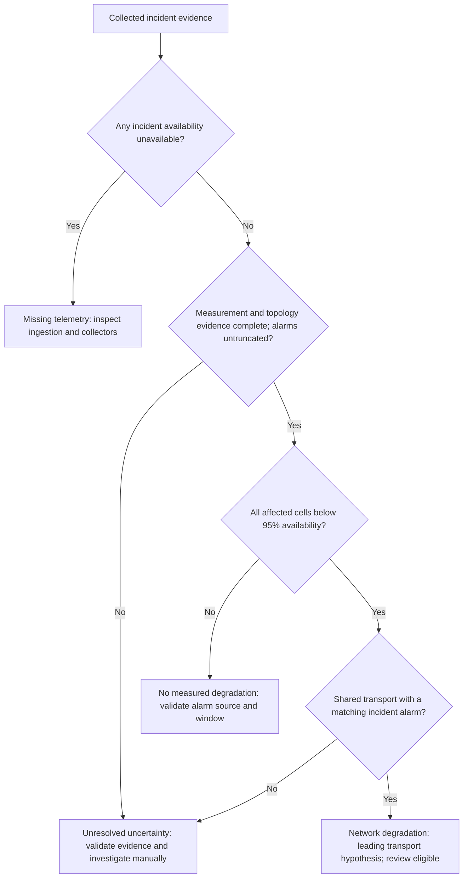
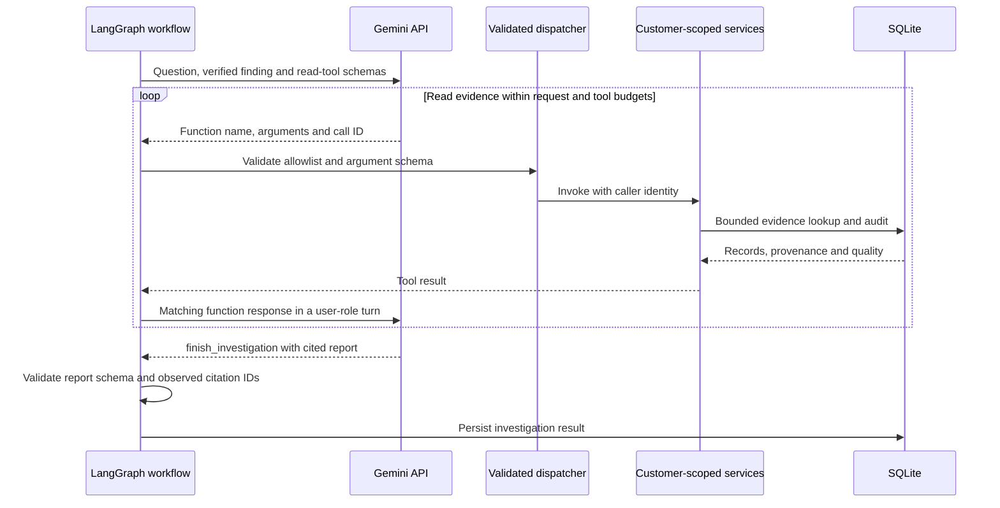

# Signal Network Intelligence

**An evidence-driven telecom operations dashboard that connects alarms, historical topology and performance measurements to explain incidents and prepare recommendations for human review.**

Signal answers three operational questions: **what is affected, what changed, and does the evidence support a recovery proposal?** It combines a React dashboard, FastAPI services, a LangGraph investigation workflow and optional Gemini tool calling. An external MCP host can use the same services through a separate stdio server.

Built for [the assignment](assignment.docx) using [the suggested library stack](libraries_to_be_used.md). **All network data is simulated.** Investigation, KPI calculation, audit and proposal review are implemented; live vendor ingestion and network-change execution are outside the demo.

## Explore the project

- [Project flow at a glance](#project-flow-at-a-glance)
- [Architecture and responsibilities](#architecture-and-responsibilities)
- [Data preparation and startup](#data-preparation-and-startup)
- [Historical topology and impact](#historical-topology-and-impact)
- [KPI calculation and trustworthy evidence](#kpi-calculation-and-trustworthy-evidence)
- [Incident investigation from request to result](#incident-investigation-from-request-to-result)
- [Gemini and MCP access paths](#gemini-and-mcp-access-paths)
- [Roles, proposals and human review](#roles-proposals-and-human-review)
- [Dashboard walkthrough and scenarios](#dashboard-walkthrough-and-scenarios)
- [Setup at a glance](#setup-at-a-glance)
- [Codebase at a glance](#codebase-at-a-glance)
- [Validation and current limits](#validation-and-current-limits)

Diagrams use Mermaid and render directly on GitHub. Each section also explains the behavior in prose.

## Project flow at a glance

An operator selects an incident. Signal identifies affected cells, reconstructs their dependencies at the incident time, compares measured availability, and decides whether the evidence is sufficient. An optional model stage explains that finding with citations. A separate human can review an eligible proposal.



For example, four cells with availability alarms may depend on one failed transport link. A shared dependency, a matching transport alarm and complete degraded measurements support that hypothesis. Missing measurements lead to a telemetry investigation instead of an outage claim.

## Architecture and responsibilities

The application has three evidence capabilities:

- **Connection Factory:** represents canonical inventory, source versions and validation outcomes. In this demo, fixtures and a generator supply the records; no live vendor connector runs.
- **Topology Engine:** resolves effective-dated dependencies between cells, nodes, sites, transports and services. Queries return bounded neighborhoods with provenance, missing-link information and truncation flags.
- **KPI Engine:** calculates versioned availability and throughput results with explicit coverage, quality and finality.

The investigation workflow combines these capabilities; the dashboard presents their evidence and the review process.



**Frontend:** React and TypeScript provide the operations workspace; TanStack Query manages server state, Axios sends requests, React Flow with Dagre draws topology, and Recharts plots KPIs.

**Backend:** FastAPI adapts REST requests; SQLAlchemy persists data; NetworkX analyzes small returned subgraphs; pandas and NumPy calculate KPIs; LangGraph orders investigation steps. Gemini uses Google's Gen AI SDK through a local, validated dispatcher.

REST, MCP and Gemini reuse the same customer-scoped service methods. The dashboard calls REST. Gemini invokes local functions through the dispatcher; it does not connect to the MCP process or query the database directly.

## Data preparation and startup

FastAPI's lifespan calls `seed()` before serving requests. The same seeder runs when the stdio MCP server starts. It creates missing tables, inserts core fixtures when absent and expands the sample network when generator settings change.



Repeated startup with unchanged settings does not duplicate data. Expansion preserves investigations, proposals, audit records and KPI revisions. Reducing generator settings does not delete previously generated records.

The default dataset contains **five customer scopes**: Atlas Mobile, Horizon Telecom, Meridian Wireless, Nova Networks and Summit Communications. Each has 18 sites, 36 nodes, 108 cells, six transports, eight services and eight incident scenarios. Across all customers, initial totals are **880 entities, 1,085 historical relationship records, 95 alarms and 51,840 counter/KPI pairs** covering 24 hours in 15-minute windows.

The sample clock is fixed: **10 November 2026, 10:05 UTC** is the incident time and **10:20 UTC** is the evidence observation time. Audit events and proposal expiry use the actual wall clock. Sample incidents do not advance with today's date.

## Historical topology and impact

Inventory describes what exists; relationships describe dependencies. Entity identity is scoped by customer, so each customer can have its own `CELL-101`. Relationships carry a kind, effective interval, recording timestamp and inventory version.

The main incident connects four cells to one transport dependency:



Arrows above follow the stored dependency direction. The dashboard reverses edges to show impact propagating from infrastructure toward dependent entities.

**Why historical time matters:** NODE-02 used TRANS-02 at 09:45 UTC. A route change effective at 10:00 UTC moved it onto TRANS-01; that record was received at 10:02 UTC. At the 10:05 incident snapshot, NODE-01 and NODE-02 therefore share TRANS-01.



`as_of` selects relationships effective at the event time. `known_at` filters newly recorded relationships by what had arrived. Interval-closure knowledge and entity attributes are not independently versioned, so the prototype does not provide complete bitemporal reconstruction. Status colors are simulated incident annotations.

Topology neighborhoods allow up to **two hops, 100 entities and 300 edges**. Shared-dependency queries accept at most **ten entities**. Invalid reference examples are excluded from trusted edges and exposed in **Data quality**; incomplete or truncated results remain explicitly marked.

## KPI calculation and trustworthy evidence

The KPI engine turns raw cell counters into measurements with reporting-window and quality metadata. Windows are UTC, half-open 15-minute intervals: `[start, end)`. Investigation compares earlier availability against the **10:00–10:15 UTC** incident window.



```text
availability (%) = 100 × sum(successful_seconds) / sum(observed_seconds)
completeness     = min(1, received samples / expected samples)
throughput       = sample-weighted mean of throughput measurements
```

Counter aggregation sums the numerator and denominator before division. Missing or invalid availability is **null**, rather than zero. Partial coverage can carry a measured value, but it cannot pass the workflow's complete-evidence gate.

For example, CELL-103 has no incident-window samples and returns unavailable availability. CELL-301 receives eight of fifteen expected samples and returns partial quality. Neither supports a network-change proposal.

**Quality and finality are separate:** complete means all expected samples are present; final means calculation occurred at least two hours after the window ended. Complete incident measurements can still be provisional. Results retain formula version, revision and calculation time. `publish()` preserves older revisions and is idempotent for unchanged results; late-data publication is tested, but no background recalculation/finalization scheduler runs.

## Incident investigation from request to result

An investigation starts when an operator runs it from **AI workbench**, sends a REST request or invokes MCP `investigate`. Seeded alarms do not trigger background investigations automatically.

The implemented LangGraph node order is:



1. **Scope the request.** The caller's identity supplies customer and role. Tool arguments cannot override either. Approvers can read results but cannot initiate investigations.
2. **Gather evidence.** Read incident alarms, identify affected cells, find shared dependencies and fetch KPI series through the shared services.
3. **Evaluate the evidence in code.** Calculate classification, confidence, uncertainties, target and `can_recommend` before asking a model to explain anything.
4. **Produce a report.** Return a local evidence response or let Gemini inspect additional read tools and produce an answer with observed-ID citations.
5. **Persist and explain.** Store the result and audit events. Return measurements, role-specific next steps, provider/fallback metadata and a trace of tool calls with durations and request IDs.

### How a recommendation is decided



Only the complete, degraded and corroborated transport case sets `can_recommend=true`. Correlation still needs physical diagnostics. Gemini cannot change this classification, the measured KPIs, the target or proposal eligibility.

The result includes `classification`, `confidence`, `evidence`, `shared_dependencies`, `uncertainties`, `role_output` and `agent_response`. `trace` shows tool attempts; `provider`, `model`, `mode`, `llm_used` and `llm_error` explain how the report was produced. `mode=fallback` identifies a failed provider stage followed by a local response.

## Gemini and MCP access paths

### Optional Gemini reasoning

Gemini receives the question, deterministic finding and five allowed read-tool schemas. It must successfully read evidence before returning `finish_investigation` with an answer, next steps and citations. SDK automatic function execution is disabled; application code validates names and arguments and dispatches using the existing caller identity.



The five read tools are `get_entity`, `get_topology_neighbors`, `get_kpi_timeseries`, `get_alarm_context` and `get_shared_dependencies`. Proposal creation, approval and execution are outside Gemini's tool allowlist.

Agent modes are **`auto`** (Gemini when configured, with explicit local fallback), **`deterministic`** (local evidence only) and **`llm`** (provider success required; failure returns HTTP 503). Defaults allow **16 top-level tool attempts, four model requests, a 30-second workflow deadline and a 15-second model-request timeout**. Failed attempts and budgeted retries consume the request allowance. These are in-process bounds, not a hard cancellation guarantee for every blocked operation.

The backend releases its SQLite transaction before external model I/O. Transient provider failures may receive one retry within the remaining budget. Report schema and cited IDs are checked; citation validation alone cannot establish the semantic correctness of every sentence.

### External MCP access

MCP is a **separate stdio JSON-RPC process**, implemented in [backend/mcp_server.py](backend/mcp_server.py). An MCP-compatible host launches it with a fixed demo identity from `SIGNAL_DEMO_TOKEN`. There is no HTTP `/mcp` endpoint.

It exposes the five read tools above plus **`investigate(incident_id, question)`** and **`propose_action(investigation_id)`**. Those use the same workflow and proposal service as REST. MCP exposes no approval or execution tool. Start from the repository root with `SIGNAL_DEMO_TOKEN=demo-atlas-alarm .venv/bin/python -m backend.mcp_server`; the process then waits for protocol messages on stdin. A host configuration must use the environment's absolute Python path and set the repository root as its working directory or Python module path.

## Roles, proposals and human review

Local demo tokens use `demo-<customer>-<role>`, for example `demo-atlas-alarm`. The dashboard's customer and role selectors demonstrate scope and permissions; these public identities are intended for local demonstration.

- **Alarm management:** reads evidence, investigates incidents, drafts incident updates and proposes review.
- **Performance analysis:** reads evidence, investigates trends and proposes review.
- **Change planning:** reads evidence, investigates impact, prepares change/rollback guidance and proposes review.
- **Human approver:** reads findings and records review; cannot initiate investigations or create proposals.

```mermaid
stateDiagram-v2
    [*] --> InvestigationSaved
    InvestigationSaved --> ProposalBlocked: Insufficient evidence
    InvestigationSaved --> Pending: Eligible finding and proposer permission
    Pending --> ApprovedForReview: Independent approver passes validation
    Pending --> Pending: Invalid review rejected; status retained
    ApprovedForReview --> [*]: Review recorded
    ProposalBlocked --> [*]
    note right of Pending
        Review checks customer scope, role,
        proposer identity separation, pending status,
        30-minute expiry and critical target state.
        Expired proposals remain stored as pending
        but cannot be approved.
    end note
    note right of ApprovedForReview
        Stored status is approved_for_review.
        No network change is executed.
    end note
```



A proposal references a persisted investigation and explicit target. Failed review does not convert it into an approved action. Expiry is checked when review is requested; no background expiry job runs. Every request to the execution endpoint is refused with HTTP 403. A real executor would need separate authorization and live-state revalidation.

## Dashboard walkthrough and scenarios

The workspace follows the operator's investigation:

1. **Overview / Alarms & incidents:** inspect customer metrics, alarms and incident groups; select **INC-1005**.
2. **Network topology:** inspect the affected cells and shared TRANS-01 dependency. Switch between **09:45** and **10:05 UTC** to see NODE-02's backhaul change; use **Full network** for the complete customer graph.
3. **KPI explorer:** compare availability or throughput over 2, 12 or 24 hours and inspect completeness/finality.
4. **AI workbench:** ask a question and run the investigation. Review the finding, cited answer, measured evidence, uncertainties and tool trace.
5. **Review proposal:** draft an eligible proposal, switch to **Human approver**, and record independent review.
6. **Data quality / Audit trail:** inspect missing samples, unresolved references, tool attempts and decisions. Export a JSON snapshot for the selected customer and incident.

Topology snapshot controls affect relationship queries; they do not move the fixed investigation window or the independently selected KPI history range.

Eight seeded scenarios demonstrate different outcomes:

- **INC-1005 — West cluster transport incident:** four cells, shared TRANS-01, a link-down alarm and complete degraded measurements; review eligible.
- **INC-1020 — Bandra telemetry gap:** missing CELL-103 measurements; missing telemetry.
- **INC-1035 — Powai availability anomaly:** partial CELL-301 measurements and unresolved inventory; uncertain evidence.
- **INC-2005 — North aggregation link failure:** a second corroborated transport case involving TRANS-03.
- **INC-2020 — Vendor collector delay:** missing CELL-501/CELL-502 samples; investigate ingestion.
- **INC-2035 — Partial east-sector measurements:** incomplete CELL-601/CELL-602 samples; manual investigation.
- **INC-2050 — Alarm with healthy counters:** measurements do not corroborate degradation; no proposal.
- **INC-2060 — Radio capacity regression:** degraded measurements without a matching shared transport alarm; unresolved cause.

## Setup at a glance

Use **Python 3.12+**, **Node.js 20.19+ or 22.12+**, and npm. From the repository root, run the backend:

```bash
python3.12 -m venv .venv
source .venv/bin/activate
python -m pip install -r backend/requirements.txt
python -m uvicorn backend.main:app --reload --host 127.0.0.1 --port 8000
```

In a second terminal, from the repository root:

```bash
cd frontend
npm ci
npm run dev
```

Open the [dashboard](http://127.0.0.1:5173), [interactive API docs](http://127.0.0.1:8000/docs) or [health endpoint](http://127.0.0.1:8000/api/health). Startup prepares sample data automatically. Vite proxies `/api` to `http://127.0.0.1:8000`; SQLite defaults to `backend/data/signal.db`.

No model key is required for local evidence reports. To enable Gemini, create `backend/.env` from [backend/.env.example](backend/.env.example) if it does not already exist, set `GEMINI_API_KEY`, choose a function-calling `GEMINI_MODEL` available to your API project, and use `SIGNAL_AGENT_MODE=auto`. Restart after environment changes. Keep credentials in the ignored backend environment file; `VITE_` values are public browser configuration.

[frontend/.env.example](frontend/.env.example) documents the API base URL, timeout and Vite proxy target. Process environment values take precedence over `backend/.env`, then the optional root `.env`. `GET /api/v1/agent/status` reports configuration without exposing credentials; a real investigation verifies provider connectivity.

Try the same investigation through REST:

```bash
curl -sS http://127.0.0.1:8000/api/v1/investigations \
  -H 'Authorization: Bearer demo-atlas-alarm' \
  -H 'Content-Type: application/json' \
  -d '{"incident_id":"INC-1005","question":"What is the likely shared cause and supporting evidence?"}'
```

See [the REST/MCP contract](docs/api-contract.md) for topology requests, response fields, error semantics and query limits.

## Codebase at a glance

```text
backend/
  main.py                  FastAPI routes, startup and request context
  auth.py / config.py      Caller permissions and environment settings
  database.py              SQLAlchemy records and SQLite configuration
  seed.py / scenarios.py   Reproducible inventory, counters and incident cases
  mcp_server.py            Separate stdio MCP adapter with seven tools
  services/
    tools.py               Shared customer-scoped evidence queries
    kpi.py                 Formulas, quality, finality and revision publication
    investigation.py       LangGraph nodes and deterministic decision rules
    gemini_agent.py         Validated model-tool loop, reports and fallback
    actions.py             Evidence-backed proposals and independent review
  tests/                   Platform, provider and MCP regression coverage
frontend/src/
  App.tsx                  Dashboard navigation and operator workflow
  api.ts / types.ts        HTTP client and response types
  components/              Topology graph, KPI chart, investigation panel and UI
sample_data/inventory.json Original inventory and quarantine fixtures
docs/design.md             Architecture decisions and proposed production migration
docs/api-contract.md       REST/MCP examples and operational limits
```

Storage holds customers, canonical entities, effective-dated relationships, inventory versions, raw counters, KPI revisions, alarms, investigations, proposals, audit logs and generator state. Investigations retain evidence and agent output as JSON; audit entries carry customer, actor, role, timestamp, request ID and operation details. SQLite enables foreign keys and WAL mode.

For the main request path, start at `frontend/src/App.tsx`, follow `/investigations` into `backend/main.py`, then read `services/investigation.py`. Evidence queries live in `tools.py`, optional model reasoning in `gemini_agent.py`, and the subsequent proposal/review flow in `actions.py`.

## Validation and current limits

Backend tests use a temporary database. They cover historical topology, weighted KPIs, missing/partial measurements, late revisions, tenant collisions, role restrictions, review expiry, audit evidence and idempotent seeding. Gemini tests mock provider behavior while exercising SDK request formatting, tool/citation validation, retries and budgets; MCP coverage starts a real stdio client/server session without spending model credits.

For validation, install pytest if it is not already available, then run from the repository root:

```bash
.venv/bin/python -m pip install 'pytest>=8,<10'
.venv/bin/python -m pytest -q
.venv/bin/python -m pip check
npm --prefix frontend run build
```

If the dashboard cannot reach the API, check both servers, `/api/health` and the Vite proxy target. If reports stay local, inspect `/api/v1/agent/status` and restart after updating the backend environment. Missing/partial evidence and expired proposals intentionally prevent approval or recommendation; inspect the evidence and request a fresh investigation when appropriate.

The demo uses fixed scenarios, local SQLite storage and public development identities. It has no live ingestion connector, automatic investigation trigger, background KPI finalization or network executor. Historical relationship queries demonstrate the seeded route change; full temporal correction history remains future work. Model citations supplement measured evidence and human review.

The assignment's production scale and latency requirements are **design targets, not benchmark results**. [The design note](docs/design.md) describes a proposed migration to event-driven ingestion, immutable raw storage, PostgreSQL inventory/topology, BigQuery counters/KPIs, verified production identity, stronger tenant isolation and a separately authorized execution service.
