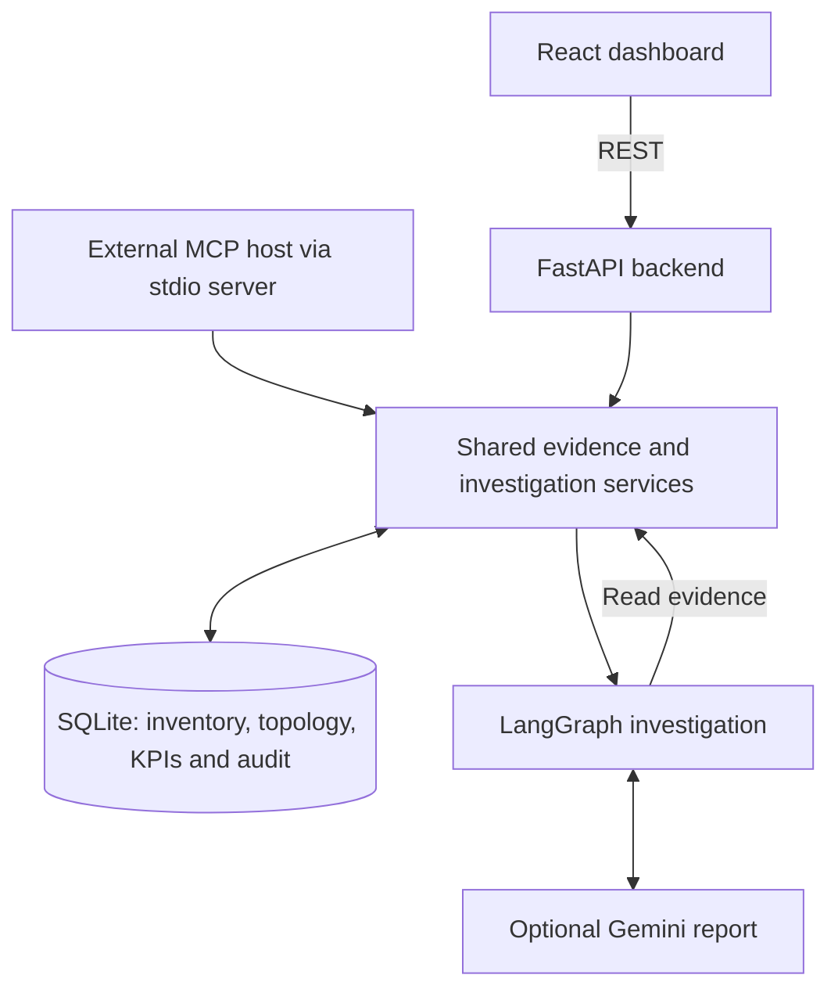
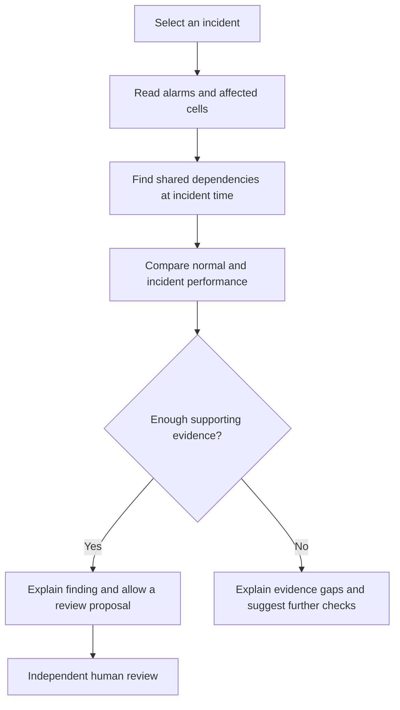

# Signal Network Intelligence

Signal is a telecom network monitoring demo that connects **alarms, network topology and performance measurements** to help operators investigate incidents and prepare recommendations for human review.

Built for [the assignment](assignment.docx) using [the suggested library stack](libraries_to_be_used.md). All network data is simulated; the application does not execute network changes.

## What it does

- Shows network entities, connections, alarms and performance charts for five customers.
- Reconstructs connections at the incident time to identify shared dependencies.
- Compares normal performance with incident measurements and flags missing or partial data.
- Runs an investigation with a local evidence report or an optional Gemini explanation.
- Supports role-based proposals, independent human review and an audit trail.

## Architecture



**Frontend:** React, TypeScript, React Flow, Recharts and TanStack Query provide the dashboard, topology view and KPI charts.

**Backend:** FastAPI exposes the API, SQLAlchemy manages SQLite storage, NetworkX finds dependencies, and pandas/NumPy calculate KPIs. LangGraph organizes the investigation steps. REST, MCP and the Gemini tool dispatcher reuse the same customer-scoped services.

Sample inventory, counters and alarms are prepared automatically at startup. Repeated startup preserves existing investigations and review records.

## How an investigation works



For example, **INC-1005** affects four cells that share **TRANS-01**. A link-down alarm and complete degraded measurements support a transport-failure hypothesis. The operator can draft a proposal for human review; physical diagnostics are still needed to confirm the cause.

Three rules keep the result grounded:

- **Use the right topology:** NODE-02 moves from TRANS-02 to TRANS-01 at 10:00 UTC. Viewing the earlier network would miss the shared dependency.
- **Check measurement quality:** KPIs use 15-minute windows. Missing availability is null, and incomplete measurements cannot support a change proposal. Complete measurements can remain provisional during the two-hour lateness allowance.
- **Keep decisions in code:** Gemini can read approved tools and explain evidence with citations. It cannot change KPI values, proposal eligibility or approval decisions.

The sample incident time is fixed at **10 November 2026, 10:05 UTC**. Proposal expiry uses the actual clock. Alarm, performance and change roles can investigate and propose; a separate approver records review. Review does not execute a network change.

## Try the dashboard

1. Open **Overview** and select **INC-1005**.
2. Use **Network topology** to compare the before/incident snapshots, then inspect **KPI explorer**.
3. Run the incident in **AI workbench** and review its finding, evidence and tool trace.
4. Draft an eligible proposal and switch to **Human approver** to review it in local demo mode.
5. Try **Missing telemetry** or **Healthy counter evidence** to see why some incidents do not permit a proposal. Inspect **Data quality** and **Audit trail** for details.

## Quick setup

Requires **Python 3.12+**, **Node.js 20.19+ or 22.12+**, and npm.

From the repository root, start the backend:

```bash
python3.12 -m venv .venv
source .venv/bin/activate
python -m pip install -r backend/requirements.txt
python -m uvicorn backend.main:app --reload --host 127.0.0.1 --port 8000
```

In another terminal, start the frontend:

```bash
cd frontend
npm ci
npm run dev
```

Open the [dashboard](http://127.0.0.1:5173) or [API docs](http://127.0.0.1:8000/docs). Vite proxies API requests to the backend, and SQLite defaults to `backend/data/signal.db`.

**Optional Gemini setup:** create `backend/.env` from [backend/.env.example](backend/.env.example) if needed, set `GEMINI_API_KEY` and an available `GEMINI_MODEL`, then restart the backend. `SIGNAL_AGENT_MODE=auto` uses Gemini when configured and falls back visibly on provider failure; `deterministic` runs locally, while `llm` requires a successful provider response. Keep API keys on the backend.

For external MCP access, launch `backend.mcp_server` from the repository root with `SIGNAL_DEMO_TOKEN=demo-atlas-alarm`. It exposes seven stdio tools over the same services, including investigation and proposal creation. The dashboard itself uses REST.

## Codebase at a glance

```text
backend/
  main.py                 API routes and startup
  auth.py / config.py     Identity, roles and settings
  database.py / seed.py   Storage and sample data
  mcp_server.py           Stdio MCP tools
  services/
    tools.py              Inventory, topology and KPI queries
    kpi.py                KPI calculations and revisions
    investigation.py      LangGraph workflow and evidence rules
    gemini_agent.py        Optional model tool loop and reports
    actions.py            Proposals and human review
  tests/                  Backend regression tests
frontend/src/
  App.tsx                 Dashboard and operator controls
  components/             Topology, KPI charts and investigation panel
  api.ts / types.ts       API client and response types
sample_data/              Inventory fixtures
docs/                     Design, API contract and deployment guides
```

## Validation and further reading

Run from the repository root:

```bash
.venv/bin/python -m pip install -r backend/requirements-dev.txt
.venv/bin/python -m pytest -q
npm --prefix frontend run build
```

This is a sample-data application with no live vendor connector, background KPI finalization or network executor. Production scale and latency targets have not been benchmarked. Public demo identities are for local development; production uses verified OIDC tokens.

More detail: [design and production plan](docs/design.md), [REST/MCP contract](docs/api-contract.md), and [Render/Vercel deployment](docs/deployment.md).
