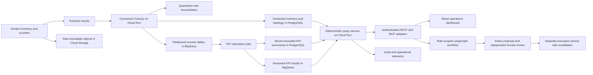

# Telecom network intelligence design note

The first release should establish whether an alarm is supported by trustworthy topology and measurements, with a traceable recommendation for a human. The supplied workload is a production design target; this runnable demo demonstrates the investigation semantics on small simulated networks rather than claiming production capacity.

## Architecture

The local equivalent uses FastAPI for the adapters, SQLAlchemy and SQLite for all tables, pandas/NumPy for KPI calculation, NetworkX for bounded subgraphs, and a React Flow dashboard. The stdio MCP server runs separately and calls exactly the same services. It does not send requests back through REST or bypass the service permission checks.

## Runtime and storage choices

Use synchronous Cloud Run services for authenticated bounded topology and recent KPI requests. Use Pub/Sub events for ingestion completion, new alarms, data corrections and KPI-ready notifications. Keep delivery idempotent with stable vendor record identifiers and source revision numbers. Retain raw payloads, arrival timestamps, checksums and parsing versions in Cloud Storage for replay and explanation.

Use Cloud Run Jobs for scheduled inventory reconciliation and bounded backfills. Partition and cluster BigQuery counters by event date, customer and entity, and calculate windows in batches around the 15-minute bursts. Avoid scanning raw counters on every agent tool call. Publish compact recent summaries into the transactional read store for predictable incident lookups. Large historical analysis can be asynchronous and return a job handle.

Start topology in PostgreSQL with customer-leading indexes and bounded recursive queries over relationships. Use a connection pool and cap Cloud Run instances against the database connection budget. Maintain inventory writes, proposals and approvals transactionally. Firestore is unnecessary initially because these interfaces benefit from relational constraints and transactional checks. A separate graph database adds operational cost before deep traversal demand is proven. NetworkX should process only a bounded returned subgraph.

The small team should start with managed runtimes and avoid GKE. Reconsider GKE or managed stream processing if sustained throughput, connector requirements or long-running stateful computation exceed the selected job/event model. Evaluate a graph database if real two-hop and impact-analysis benchmarks miss the latency target despite indexes, materialized adjacency and caching. Revisit PostgreSQL sizing and read replicas if 100 investigations cause queueing. Measure BigQuery scan bytes, ingestion lag, per-incident query cost and replay cost before changing the storage split. These are proposed choices to validate with the team's workload and Google Cloud configuration.

## Inventory and topology correctness

Use `(customer_id, canonical_entity_id)` everywhere, including foreign keys and vendor aliases. Inventory says what exists; effective-dated relationships describe connectivity. Quarantine missing identifiers, impossible references and conflicts; deduplicate exact source revisions. Preserve the raw record and rejection reason instead of silently inventing a trusted edge. Resolve vendor aliases through an explicit customer-scoped mapping with source authority rules.

Production inventory should preserve both effective time and system recording time, including closure/replacement events. An alarm query needs `as_of` for event time and optionally `known_at` for what was known during an earlier investigation. Late corrections append revisions and supersede the appropriate interval without erasing what a prior agent observed. Re-run affected investigations when corrected evidence changes a conclusion. Entity attributes need the same history, not just edges.

The prototype implements effective intervals for a seeded backhaul change and records received timestamps. It does not implement a general correction ingestion path or complete bitemporal versioning. Its optional `known_at` filter bounds visibility of newly recorded rows; interval closures and entity attributes are not independently versioned. Full reconstruction before the system knew a closure is therefore a production gap, not a demonstrated capability.

Link counters and KPI results to canonical customer-scoped entity IDs, reporting windows and source mappings. Unresolved counter identities remain quarantined until inventory is reconciled. A topology result includes missing-link counts, inventory lineage, snapshot time and truncation; an incomplete graph is not proof that no dependency exists.

## KPI semantics and late measurements

Use UTC half-open reporting intervals `[start, end)`. Availability-v1 is `100 × sum(successful_seconds) / sum(observed_seconds)`. Aggregate counters before division, rather than averaging cell percentages. The demo weights throughput by received sample counts. Formula versions, units and vendor counter semantics must be explicit and validated before mixing vendors.

Publish value, formula version, revision, completeness, calculation time and finality independently. Completeness is received expected samples divided by configured expected samples. No received counter or an invalid denominator produces a null value, not zero availability. Partial coverage can carry an observed value with an explicit quality flag. Complete coverage may still be provisional while corrections are allowed.

Allow two hours after window end for late data. Append a KPI revision on changed inputs; preserve previous revisions and serve the latest visible revision for the requested knowledge time. Formula changes create a new version and targeted recalculation. Monitor missing windows even if no record arrived; do not derive completeness only from rows that happen to exist. Production needs a scheduler to finalize old windows, trigger dependency-aware recomputation, and track counter resets, duplicates and vendor corrections. The demo tests revision publication but does not run that scheduler.

## Tools identity and bounds

Expose `get_entity`, `get_topology_neighbors`, `get_kpi_timeseries`, `get_alarm_context`, `get_shared_dependencies`, `investigate` and `propose_action`. REST and MCP are thin adapters; callers cannot send SQL or override service identity. See [the API contract](api-contract.md) for an example.

In production, verify OIDC/OAuth claims and map the subject to authorized customer and role. Scope every service and database operation to that identity; use database policies as defense in depth. Cache keys, object paths, event payloads and audit exports also need tenant scope. The public local demo role selector is a test convenience rather than an authentication boundary against an attacker who knows all demo tokens.

Alarm agents may correlate incidents and draft updates. Performance agents may analyze and recommend, but do not draft incident updates or change plans. Change agents may assess impact and prepare plans. All three may read customer-scoped evidence and propose an evidence-backed review. Only a separate human approver records approval. No agent role may execute changes.

Topology requests allow at most two hops, 100 entities and 300 edges, with an in-process soft time check. KPI requests span at most 24 hours. Shared-dependency requests accept at most ten entity IDs. The workflow allows sixteen top-level calls and checks a configurable 30-second evidence budget between calls, with at most four Gemini model turns. Returned trace counts top-level calls; nested traversals have individual audit entries. Production additionally needs database statement timeouts, rate limits, cancellation, query byte/cost budgets, and a tenant-aware queue. The current soft checks do not establish a hard wall-clock latency guarantee during a blocked database call.

## Agent workflow and action boundaries

One LangGraph workflow is sufficient initially: collect alarm context, traverse dependencies at alarm time, compare before/during KPI windows, and classify the evidence. Deterministic code computes measurements and tests whether corroborating evidence exists. An optional Gemini function-calling stage interprets the operator's question and selects additional read tools before returning a cited narrative. Google Gen AI SDK automatic tool execution is disabled; a validated dispatcher binds all tools to the caller's identity. The model cannot alter calculated KPIs, classification, confidence, target or approval eligibility. Without a configured key, the local workflow returns a visible deterministic response; auto mode also reports explicit provider fallback. Required LLM mode returns a controlled error instead. Backend environment variables hold the API key and selected model.

The transport case identifies four cells sharing TRANS-01, a contemporaneous transport alarm, and complete but provisional degraded measurements. The result is a leading hypothesis with a request for diagnostics, not a claim that correlation proves physical root cause. The missing-telemetry case distinguishes absent measurements from failure. The conflicting-evidence case stops with partial measurements and unresolved inventory. Budget exhaustion, unknown entities and unauthorized operations return controlled failures rather than confident recommendations.

A proposed action references a persisted customer-scoped investigation with sufficient evidence and an explicit target. Independent human review expires after 30 minutes in the demo. Approval checks customer scope, role, pending status, expiry and target state. The demo records review only. A real executor must additionally verify the exact approved plan and digest, target set, live inventory revision, current state, maintenance window, approval revocation/expiry, idempotency, rollback and authorization immediately before execution. Approval is not a reusable blanket credential.

## Delivery evaluation and operations

Stage one establishes source contracts, customer identity propagation, immutable raw records, quarantine and effective-dated inventory. Validate isolation and temporal corrections first. Stage two introduces versioned KPIs with late-data fixtures and the bounded read APIs. Stage three adds the React topology, one auditable LangGraph workflow, stdio MCP and independent review proposals. Production expansion then benchmarks burst ingestion and 100 concurrent investigations before adding connectors or autonomous behavior.

Tests should cover weighted aggregation, denominator errors, null and partial measurements, duplicates, revisions, knowledge-time queries, historical edges, missing references, tenant identifier collisions, forbidden roles, truncation, expired approval, changed targets and tool failure. The runnable tests cover the demonstrated subset. Add event replay, clock/finality, correction and load tests when those production components are implemented.

Log request and investigation IDs, customer, authenticated subject, role, tool parameters within policy, effective snapshot, source revisions, output quality, latency, refusal reason and proposed action IDs. The prototype persists request IDs and decision/tool events in SQLite; production should export append-only audit evidence and use Cloud Logging, Monitoring and tracing. Alert on ingestion delay, unknown aliases, quarantine rate, KPI coverage, p95 lookup latency, investigation timeout rate, authorization failures and cost per investigation. Measure recommendation accuracy and calibration using transport-fault, missing-data and ambiguous-evidence fixtures; review unsupported claims and tool-budget violations separately.

## Assumptions and open questions

Clarify vendor counter semantics and reset rules, expected samples per cell, retention and deletion requirements, cross-customer regulatory boundaries, source authority for conflicting aliases, event-time versus knowledge-time investigation requirements, and the scope of an approvable change. Confirm whether a 30-second initial response may explicitly return partial evidence and continue asynchronously. Establish incident severity and root-cause ground truth with network operators. The demo assumes hourly inventory versions, 15-minute counter windows, a two-hour correction allowance, eight fixed scenario types across 880 entities and 24 hours of sample measurements, and no real execution integration.
